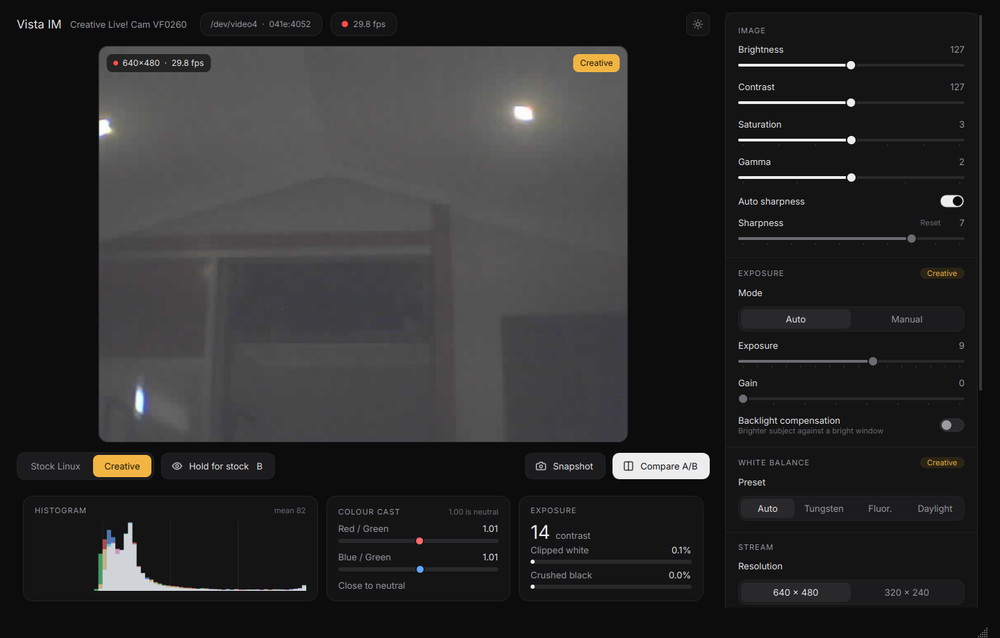
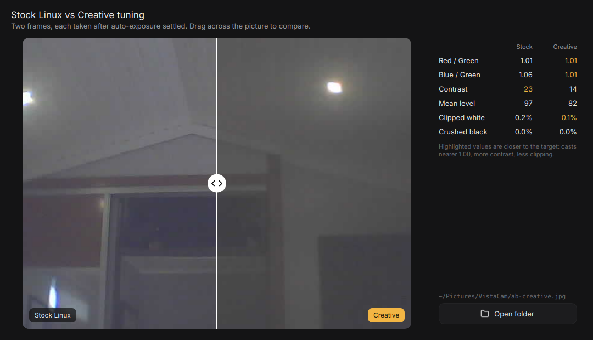

# VistaCam

A desktop app and an improved Linux driver for the **Creative Live! Cam Vista IM (VF0260)**,
USB ID `041e:4052`.

Linux has supported this 2007 webcam for years through the `gspca_ov519` driver, but only
with generic sensor settings: a washed-out picture, a cool cast, 15 fps, and five controls.
The Windows driver ships Creative's own tuning for the OV7670 sensor. This project brings
that tuning to Linux, exposes it as standard camera controls, and gives you an app to compare
the two live.



## What you get

**Driver** (`driver/`, installed with DKMS)

- 30 fps at 640×480 (stock: 15). Apps can pick 30, 20 or 15 fps.
- Creative's sensor setup: their gamma curve, colour matrix, white-balance and
  low-light settings, taken from the Windows driver's INF file.
- New controls, usable from any V4L2 app (VistaCam, `v4l2-ctl`, OBS, guvcview):
  saturation, sharpness (auto or manual), gamma, white-balance presets
  (auto, tungsten, fluorescent, daylight), backlight compensation, and manual
  exposure and gain.
- A **Creative Tuning** switch that flips between Creative's settings and the stock
  Linux ones while the camera streams, so you can compare the same scene.
- Raw OV7670 register read/write for experiments.

**App** (`src/vistacam/`, Qt 6)

- Live view with measured fps, RGB histogram, colour-cast meters and clipping meters.
- **Hold for stock** (or hold <kbd>B</kbd>): shows the stock tuning while held.
- **Compare A/B**: takes one frame with each tuning, after auto-exposure settles,
  and shows them in a drag-to-compare view with the numbers side by side.
- Every driver control, grouped and labelled. Dark and light themes.
- Snapshots go to `~/Pictures/VistaCam/`.
- Only ever opens the Vista IM, never your other cameras. Reconnects when you replug it.



## Install

Needs a Linux system with `dkms`, the headers for your running kernel, and Python 3.10+
with `venv`. On Debian or Ubuntu:

```sh
sudo apt install dkms linux-headers-$(uname -r) python3-venv
git clone https://github.com/skinnie/vistacam.git
cd vistacam
./install.sh
```

`install.sh` builds the driver with DKMS (it asks for sudo and rebuilds itself on kernel
updates), then installs the app for your user in `~/.local/share/vistacam` with a menu
entry. Options: `--driver`, `--app`, `--uninstall`.

The app also works with the stock driver. It then shows the basic controls and tells you
the patched driver is missing.

### Run from the source tree

```sh
python3 -m venv .venv && .venv/bin/pip install -e .
.venv/bin/vistacam
```

### Try the driver without installing it

```sh
cd driver && make
sudo rmmod gspca_ov519 && sudo insmod ./gspca_ov519.ko   # until reboot
```

## How it works

The camera is an OmniVision **OV519** USB bridge with an **OV7670** sensor. The bridge
sends JPEG frames.

Creative's Windows driver (`LCVA_PCDrv_US_1_11_02.exe`, 2007) is a Wise installer. Its
`V0260Vid.inf` holds the complete sensor init sequence and a register table for every
property the Windows driver offers. `driver/gen_tables.py` turns those tables into
`driver/creative_tables.h`, so every register value in the driver traces back to
Creative's file. No values are hand-tuned.

Changes to the upstream driver:

| | Stock `gspca_ov519` | This driver |
|---|---|---|
| Frame rate at 640×480 | 15 fps, hard-coded | 30 fps default, selectable |
| Sensor init | OmniVision reference values | Creative's VF0260 values |
| Controls | brightness, contrast, flips, mains flicker | plus saturation, sharpness, gamma, white balance, exposure, gain, backlight, tuning switch, register access |

`driver/ov519-vistacam.patch` is the diff against Linux 7.0's `ov519.c`. The new code
lives in `driver/ov7670_creative.c`, and only applies to the OV7670 sensor, so other OV519
cameras behave as before. The sources build against Linux 7.0. Older or newer kernels may
need small changes in `gspca.h`.

### What the tuning does

Creative's settings give a more neutral colour balance and keep highlights from clipping.
In dim indoor light they come out slightly darker than stock, and raising **Gamma** to 3 or
4 brightens them. Switching tuning resets the sensor's exposure, so allow a second for
auto-exposure to settle. Compare A/B waits for that itself.

## Repository layout

```
driver/            patched gspca_ov519, DKMS config, register-table generator
src/vistacam/      the Qt app (v4l2.py: camera access, window.py: UI)
packaging/         desktop entry and icon
tools/             off-screen screenshot renderer for the docs
install.sh         driver + app installer
```

## Legal

The driver is derived from the Linux kernel's `gspca_ov519` and is GPL-2.0-or-later, as is
the app. The register values in `creative_tables.h` were extracted from Creative's
publicly distributed Windows driver. Creative's files themselves are not included.
Inter font: SIL Open Font License (`src/vistacam/fonts/Inter-LICENSE.txt`).

Not affiliated with Creative Technology.
